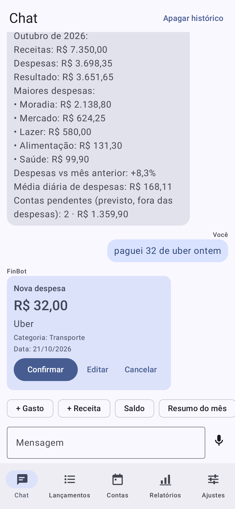
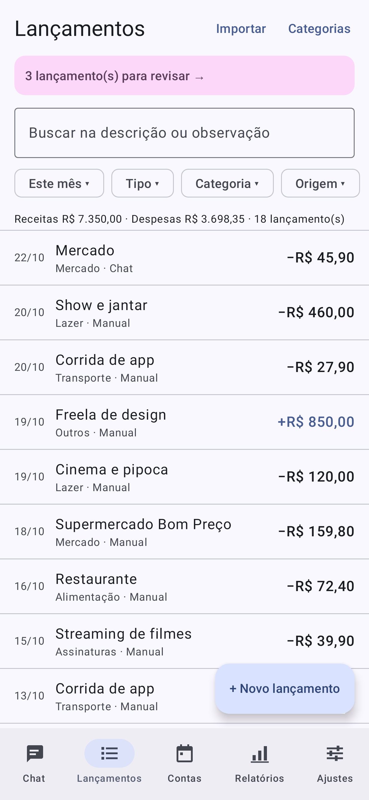
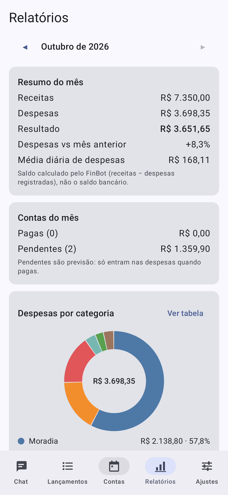
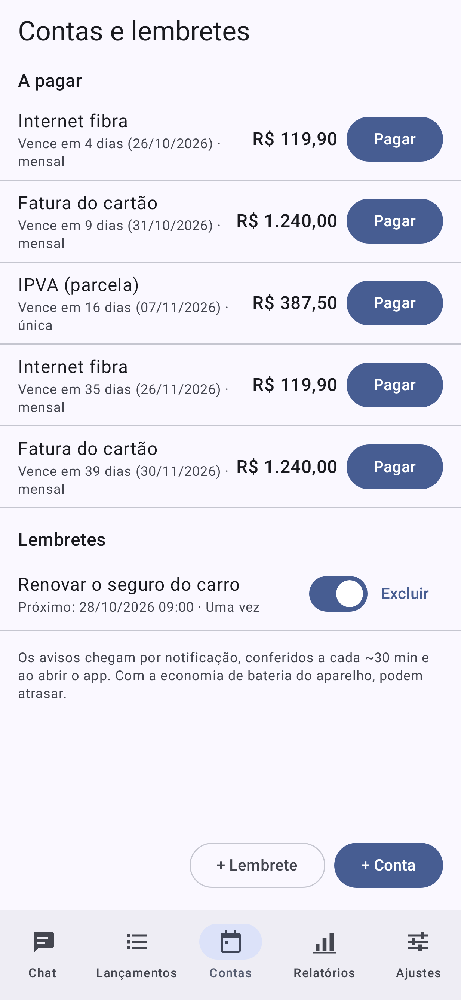
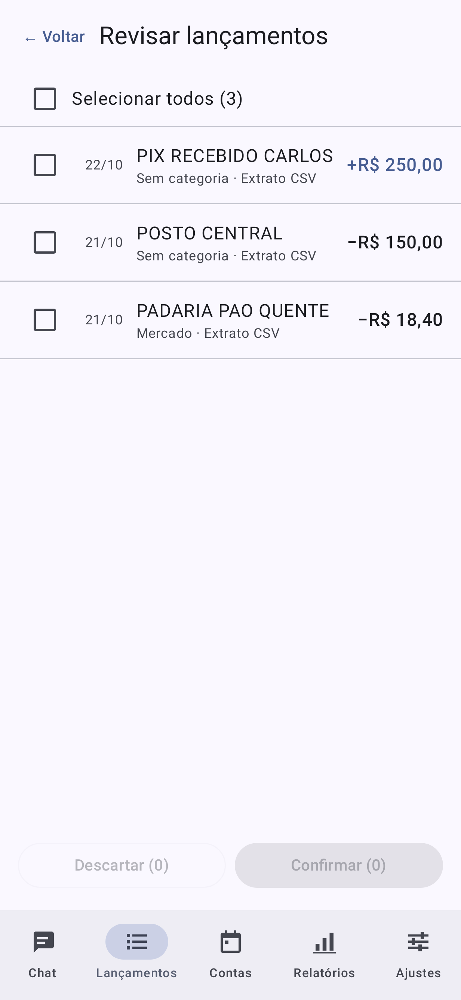
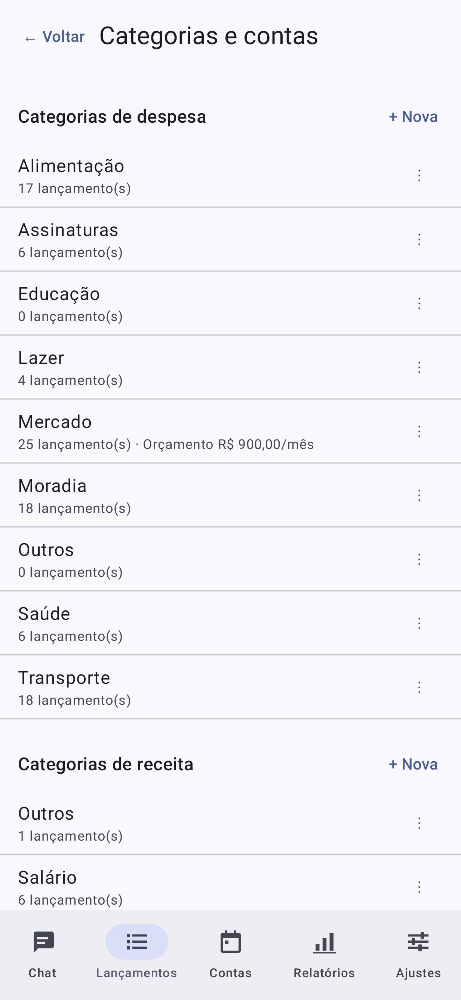
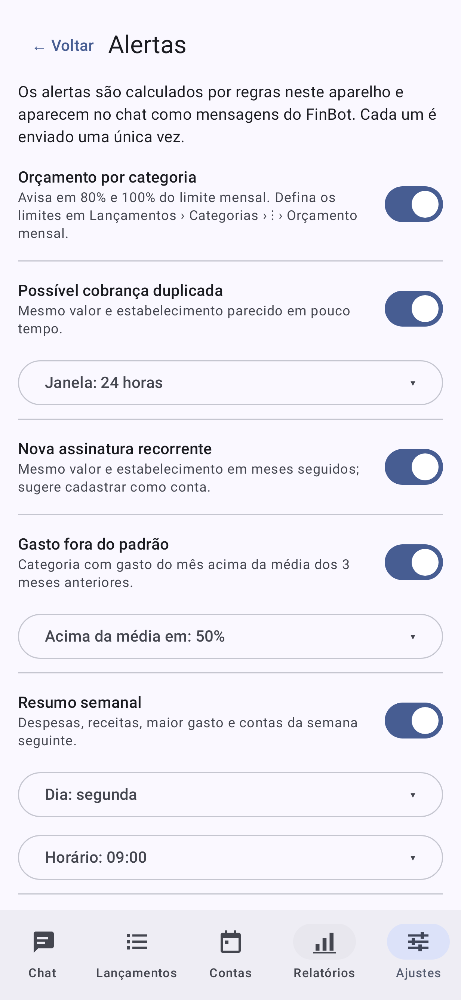
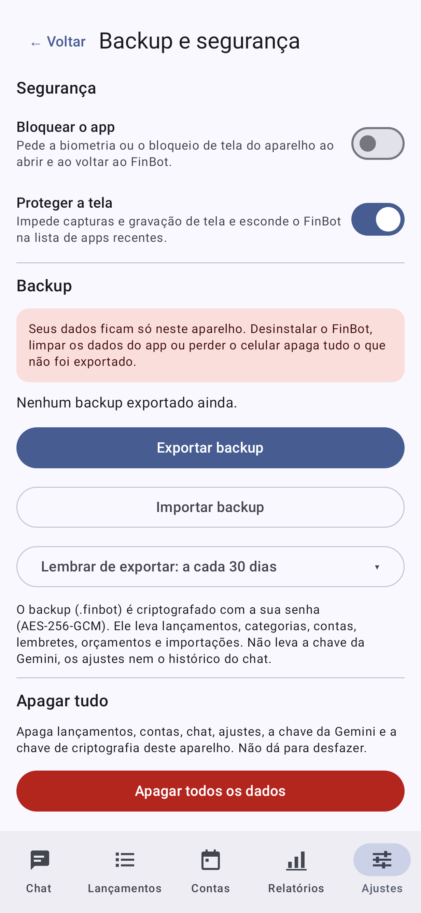
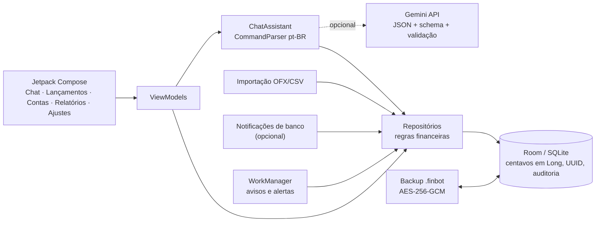

# FinBot 💬💰

**Assistente de finanças pessoais para Android, por chat, que funciona 100% no seu celular.**

Registre gastos conversando ("gastei 45,90 no mercado"), acompanhe contas a pagar, veja relatórios, importe extratos e receba alertas. Tudo fica num banco SQLite local: sem conta, sem servidor, sem nuvem. A IA (Gemini) é opcional; sem ela, o app funciona offline com comandos em português.

<p align="center">
  
  
  
  
</p>
<p align="center">
  
  
  
  
</p>

<sub>Telas reais do app renderizadas na JVM (Robolectric + Roborazzi) com dados fictícios. Para gerar de novo: `FINBOT_SCREENSHOTS=1 ./gradlew testDebugUnitTest --tests br.com.finbot.screenshots.ScreenshotsTest`.</sub>

## Funcionalidades
- **Chat em português, sem IA:** `gastei 45,90 no mercado`, `recebi 2.500 de salário`, `paguei 120 de luz ontem`, `/saldo`, `/mes`, `/gastos`, `/desfazer`. Tudo vira um **cartão de confirmação**: nada é gravado sem o seu toque.
- **IA opcional (Google Gemini):** frases livres, vários gastos numa mensagem e **mensagens de voz**. Saída em JSON com schema fechado e validada localmente; a IA só propõe.
- **Lançamentos:** filtros, busca, edição, desfazer, categorias (mesclar, arquivar, orçamento mensal) e várias contas.
- **Contas a pagar e lembretes:** recorrência mensal, avisos locais sem duplicar (WorkManager).
- **Relatórios:** resumo do mês, variação, rosca por categoria, gasto acumulado, evolução de 6 meses (gráficos nativos com alternativa em tabela) e **exportação CSV**.
- **Importação de extratos OFX/CSV:** OFX SGML/XML em UTF-8/Latin-1, CSV com mapeamento de colunas e modelos por banco, deduplicação e revisão antes de contar no saldo.
- **Notificações de banco (opcional):** compras e Pix viram sugestões para revisar. O texto não é guardado e nada sai do aparelho.
- **Alertas por regras:** orçamento (80%/100%), possível cobrança duplicada, nova assinatura, gasto fora do padrão e resumo semanal.
- **Segurança:** bloqueio por biometria, proteção de tela e **backup criptografado** (`.finbot`, AES-256-GCM + PBKDF2) para trocar de aparelho, com mesclagem sem duplicar.

## Privacidade em primeiro lugar
- Os dados ficam só no aparelho (pasta privada do app). O backup automático do Android está desligado.
- Nenhum servidor do FinBot: o único serviço externo é a Gemini, e **só** se você der o consentimento e cadastrar a sua chave.
- A chave da Gemini fica cifrada no Android Keystore. Os logs não têm valores, descrições nem mensagens.
- Sem SMS, contatos, localização, câmera ou armazenamento amplo. Arquivos só pelo seletor do sistema.
- Detalhes, limites e modelo de ameaças: [docs/SECURITY.md](docs/SECURITY.md).

## Arquitetura



| Camada | Tecnologia |
|---|---|
| Linguagem / build | Kotlin 2.4, AGP 9.4, Gradle 9.6 |
| Interface | Jetpack Compose, Material 3 |
| Dados | Room 2.8 (SQLite), DataStore |
| Segundo plano | WorkManager |
| Segurança | Android Keystore, BiometricPrompt, AES-GCM/PBKDF2 |
| IA (opcional) | Gemini `generateContent` via HTTPS, sem SDK |
| Testes | JUnit, MockWebServer, Room testing, Compose UI test, WorkManager testing |

Decisões técnicas registradas em [docs/DECISIONS.md](docs/DECISIONS.md) (ADRs).

## Instalação
1. Baixe o APK em **Releases** e abra no celular (Android 8.0+). Permita instalar apps desconhecidos para o app que abriu o arquivo.
2. **Xiaomi/POCO/Redmi (HyperOS/MIUI):**
   - se a verificação de segurança bloquear, desative-a temporariamente;
   - para os avisos não atrasarem, ative **Inicialização automática** e **Sem restrições** de bateria para o FinBot.
3. Guia completo de uso: [docs/MANUAL.md](docs/MANUAL.md).

### Compilar
Requisitos: Android Studio recente (JDK 17+), SDK Platform 37 e Build-Tools 36.
```bash
./gradlew assembleDebug
```
O APK sai em `app/build/outputs/apk/debug/`.

**Release assinado:**
1. Copie `keystore.properties.example` para `keystore.properties` (fica fora do Git) e aponte para a sua chave.
2. Rode:
   ```bash
   ./gradlew assembleRelease
   ```

### Chave da Gemini (opcional)
Crie uma API key no Google AI Studio. No app, em **Ajustes › Envio ao Gemini**, aceite o consentimento e salve a chave. A API gratuita tem cota. Com a IA ligada, o conteúdo da mensagem é enviado ao Google.

## Testes
```bash
./gradlew testDebugUnitTest lintDebug
```
Os testes instrumentados rodam no aparelho com o runner próprio:
```bash
adb shell am instrument -w br.com.finbot.test/br.com.finbot.FinBotTestRunner
```

**Na versão 1.0:**
- **157 testes JVM** e **129 instrumentados**, executados num POCO X7 Pro com Android 16 e HyperOS 3.0;
- cobrem parser pt-BR, dinheiro, recorrência, OFX/CSV, migrações do Room, Gemini via HTTP falso (429, 500, timeout), entradas hostis, backup adulterado, WorkManager, permissões e performance com 10 mil lançamentos.

Evidências e números medidos estão em [docs/TEST_PLAN.md](docs/TEST_PLAN.md).

## Limitações
- **Sem Open Finance:** não conecta a bancos; os dados vêm de você, de extratos ou de notificações.
- Lembretes dependem das restrições de bateria do fabricante e podem atrasar.
- Os padrões de notificação e CSV foram validados com amostras sintéticas; bancos reais podem precisar de ajuste.
- Lista completa e plano de evolução: [docs/ENTREGA.md](docs/ENTREGA.md).

## Documentação
| Documento | Conteúdo |
|---|---|
| [MANUAL.md](docs/MANUAL.md) | Manual do usuário |
| [SECURITY.md](docs/SECURITY.md) | Privacidade, limites e modelo de ameaças |
| [DECISIONS.md](docs/DECISIONS.md) | Decisões técnicas (ADRs) |
| [TEST_PLAN.md](docs/TEST_PLAN.md) | Testes e evidências |
| [ENTREGA.md](docs/ENTREGA.md) | Checklist, problemas conhecidos e evolução |
| [PROGRESS.md](docs/PROGRESS.md) | Diário de desenvolvimento por etapa |
| [CHANGELOG.md](CHANGELOG.md) | Mudanças por versão |

## Sobre o projeto
Projeto pessoal, sem fins comerciais. Começou como um bot do Telegram e virou um app isolado (por privacidade e para não depender de terceiros). Foi desenvolvido em etapas com testes em cada uma, com auxílio do [Claude Code](https://claude.com/claude-code).

## Licença
[MIT](LICENSE) © 2026 Luis Felipe Souza Siqueira
